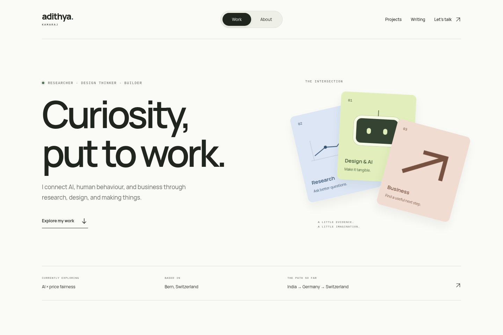

# Adithya Kamaraj — personal website

A responsive WordPress portfolio at the intersection of AI, consumer behaviour, and business. Bold typography, a consistent warm-white palette, and a few interactive details connect three spaces: **Design & AI**, **Research & Insights**, and **Startups & Business**.

[Desktop homepage](docs/previews/home-desktop.png) · [Mobile homepage](docs/previews/home-mobile.png) · [About page](docs/previews/about-desktop.png)



## Install on Bluehost

You need an existing WordPress installation running PHP 8.0 or newer. These packages require no Node.js, build service, or Webflow subscription on your hosting.

1. Download [Adi Site Content](releases/adi-site-content-1.0.0.zip) and [Adi Personal theme](releases/adi-personal-2.0.0.zip). On GitHub, open the file and use **Download raw file**.
2. Open your site's WordPress administration from Bluehost. Under **Plugins → Add New → Upload Plugin**, upload the content plugin, install it, and activate it.
3. Under **Appearance → Themes → Add New → Upload Theme**, upload the theme, install it, and activate **Adi Personal**.
4. Open **Tools → Adi site setup** and choose **Create starter content**. This creates the pages, portfolio records, and conference entries, sets Home and Writing as the site's front/posts pages, and saves suggested essays as drafts. Running it again adds missing records without overwriting existing ones. The untouched default “Hello world!” post is moved to drafts.
5. Review your profile and contact information under **Appearance → Customize → Personal site**. Review the About page and portfolio cases in the editor before sharing the site.
6. If you change permalink settings, open **Settings → Permalinks** and save them. Clear Bluehost's cache after updating the theme or content.

## Edit the site

- **Projects:** add a title, excerpt, full case study, and one or more Spaces. Portfolio details include your role, period, outcome, source link, and illustration. A featured image replaces the illustration. The Order field controls project order.
- **Publications:** add a title, venue in the excerpt, year, citation, and source URL. Entries appear in About and the Research space.
- **Writing:** publish standard WordPress posts. Categories become writing-topic links. Published posts appear on the homepage and Writing page automatically. Three essay ideas are supplied as unpublished drafts; no generated essay is attributed to you as a published article.
- **About:** edit the biography and background under Pages → About. The headline and short biography are in the Customizer. Geography panels and playground prompts are intentionally small curated components; their copy is in `page-about.php` and `template-parts/playground.php`.
- **Global details:** name, introductory copy, location, collaboration invitation, email, and profile links are editable in the Customizer.

The content plugin keeps projects and publications separate from presentation, so their records stay in WordPress when you change themes. It never automatically imports content on activation.

## Features

- Work/About switch, responsive mobile navigation, and keyboard access.
- Six initial portfolio cases grounded in the supplied CV and BFH profile.
- Dedicated project and Space archives, full case pages, related work, and pagination.
- Two 2026 conference contribution records, linked to institutional sources.
- A local dotted globe with India, Germany, and Switzerland selectors and readable country stories.
- A price-comparison illustration, a small interactive robot, and startup question prompts.
- Writing archives, category navigation, search, full articles, and reading times.
- Reduced-motion support, useful navigation without JavaScript, local fonts, and no analytics or tracking integrations.

## Local development

Install Docker with Compose. From the repository root:

```bash
./scripts/dev-setup.sh
```

Open `http://127.0.0.1:8080` **on the machine running Docker** and complete WordPress's initial installation if this is a fresh database. This loopback URL is not a public cloud preview. Then activate the plugin/theme and import the content, or run:

```bash
docker compose exec -T wordpress php /var/www/html/wp-content/plugins/adi-site-content/cli/setup.php
```

The `.env` file uses local-only sample database credentials and is ignored by Git. The database and WordPress installation are kept in named Docker volumes. `docker compose down` stops the site without removing its content.

For local browser checks, use Node.js 22+:

```bash
npm ci --cache /tmp/adi-npm-cache
npm run check
```

Checks use installed Chromium at `/usr/bin/chromium`; set `CHROMIUM_PATH` for another installation, or install Playwright's browser with `npx playwright install chromium`. They run against local Docker WordPress, create temporary content, and remove it afterward. They cover dynamic publishing, real routes, filters, playground interactions, geography, search, keyboard navigation, layouts at 320/390/768/1440px, no-JavaScript fallback, and axe accessibility checks.

Rebuild the upload packages after editing source:

```bash
npm run package
```

Node.js is only for development checks. PHP, CSS, and the small JavaScript file are served directly by WordPress.

## Sources and assets

[Content provenance](docs/profile-sources.md) · [Asset credits](docs/assets.md)

The initial copy should be reviewed as Adithya's portfolio narrative. This repository and its upload packages do not include the private CV, credentials, WordPress core, or the local database. Pushing this repository does not deploy it to Bluehost.
